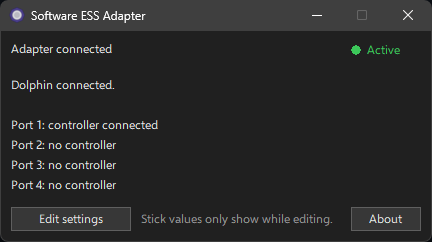
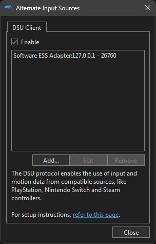
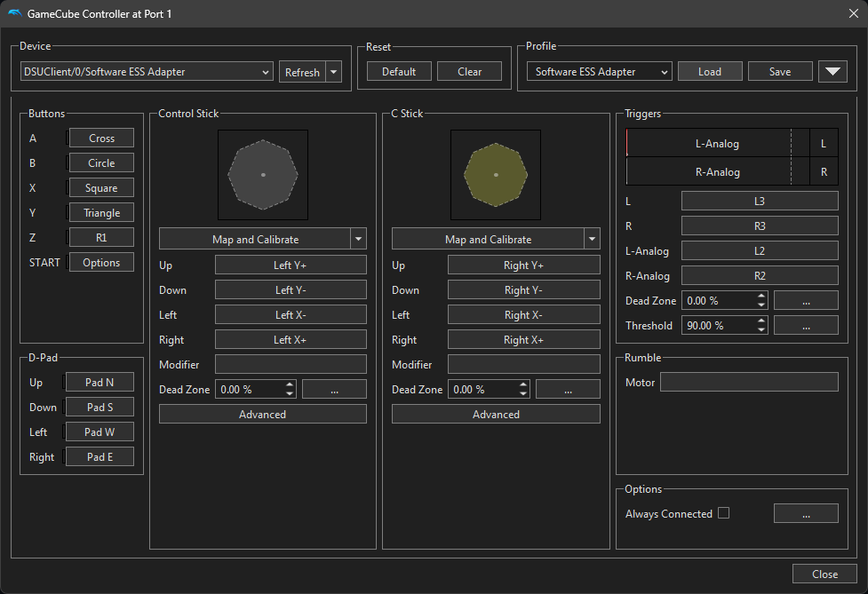
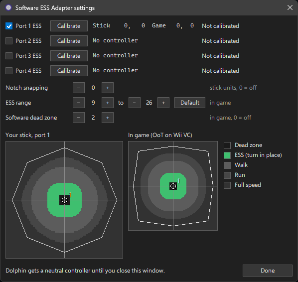
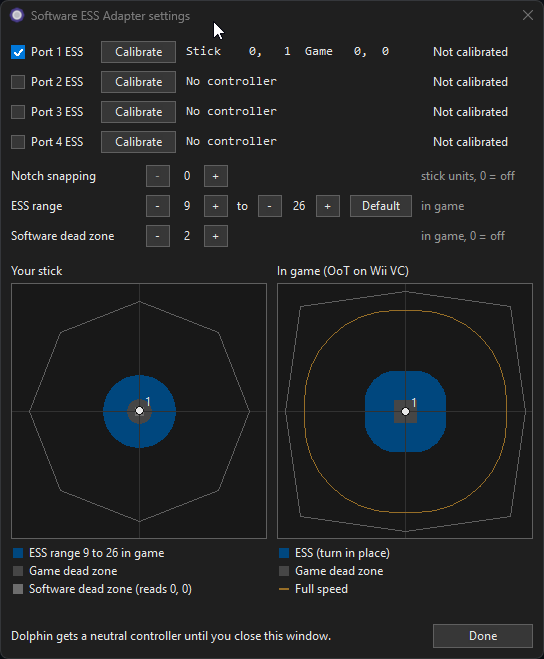
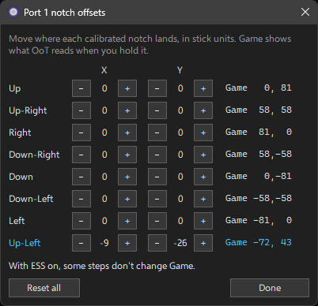

# Software ESS Adapter

Play Ocarina of Time (Wii VC) in Dolphin with N64-like stick feel, using your Gamecube controller and the official Gamecube controller adapter. No extra hardware needed. Runs on Windows and Linux.



How it works and how to build it is in [DEVELOPMENT.md](DEVELOPMENT.md).

## Setup

1. If your adapter has a mode switch, set it to Wii U/Switch mode, not PC mode. If Dolphin has already worked with your adapter in this mode, using "GameCube Adapter for Wii U" as the controller type, skip to step 2. Otherwise:
   - **Windows:** set up the adapter driver as the [Dolphin guide](https://dolphin-emu.org/docs/guides/how-use-official-gc-controller-adapter-wii-u/) describes.
   - **Linux:** open a terminal in the folder you downloaded, run these two commands, then unplug the adapter and plug it back in.

     ```
     sudo cp 51-gcadapter.rules /etc/udev/rules.d/
     sudo udevadm control --reload-rules && sudo udevadm trigger
     ```
2. Start `Software ESS Adapter.exe` on Windows, or `software-ess-adapter` on Linux. The top line should say "Adapter connected".
3. In Dolphin, open Controllers. Set each Gamecube port you use to **Standard Controller**. Don't pick "GameCube Adapter for Wii U".
4. Click Alternate Input Sources, check Enable, and add a server: description `Software ESS Adapter`, address `127.0.0.1`, port `26760`. The Software ESS Adapter window should now say "Dolphin connected."

   

5. In Dolphin, click File, then Open User Folder. Copy `dolphin/Software ESS Adapter.ini` from the download into `Config/Profiles/GCPad/` in that folder.
6. In Controllers, click Configure next to port 1. Pick device `DSUClient/0/Software ESS Adapter`, pick the `Software ESS Adapter` profile and click Load. Port 2 uses `DSUClient/1/Software ESS Adapter`, and so on.

   

7. Don't change the Control Stick dead zone or calibrate the Control Stick in Dolphin. The profile already has them set right. If you changed them, load the profile again.

That's it. Keep Software ESS Adapter open while you play.

## The main window

The light in the top right corner shows whether your controller reaches the game:

- **Active (green):** it does.
- **Paused (amber):** the settings window is open, so the game gets no input.
- **Idle (gray):** Dolphin isn't connected, or no controller is plugged in. Check Setup step 4 and that Dolphin is running.

If your stick doesn't rest at center, unplug the controller and plug it back in without touching the stick. With calibrated notches you don't need to (see Notch calibration).

## Before a run

Set everything up in the settings window, then close it. Don't open it again, calibrate, or change any setting during a run. The rules allow one mapping and calibration per run, and the settings window shows stick values you're not allowed to see during a run.

## Settings

Click Edit settings to open the settings window. While it's open, the game gets no input from your controllers. Close it, or click Done, to play again.



- **ESS:** one checkbox per port. Leave it checked for OoT on VC. Unchecked sends your stick to the game unchanged.
- **ESS range:** where ESS starts and ends, in in-game values. The default, 9 to 26, feels like a normal ESS adapter. Lower the start or raise the end for a wider ESS range (the end goes up to 45). Default puts both back.
- **Software dead zone:** makes a stick that rests slightly off center read exactly 0, 0 in game. You'd only notice the difference in tools like gz. Default is 2, 0 turns it off.
- **Notch snapping:** see Notch calibration. Off by default.

The two plots show where your stick is, one dot per controller. The colors show what Link does there. Green is ESS: hold the stick in the green to turn in place. "Your stick" is your stick, and "In game" is what the game gets.

Your settings are saved next to the program, and load again next time you start it.

## Notch calibration

Notch calibration makes your notches read exactly like a perfect controller's notches in game.

1. In the settings window, click Calibrate on your controller's port.
2. Follow the line at the bottom of the window. For a notch, hold the stick in that notch and press A. For Neutral, let go of the stick and press A. A blue ring shows where the stick should go. B cancels.
3. If you press A outside the notch it asks for, it asks again.
4. After 16 steps the port shows Notch offsets and Clear. Clear removes the calibration and its notch offsets.

<!-- Recording: a full calibration in the settings window, all 16 steps.
     GIF: keep the line below. MP4: GitHub won't play a video from the repo. Drag the file into
     GitHub's README editor instead, and it uploads it and puts its own link on its own line here. -->


Calibrations belong to the adapter port, so calibrate again if you move your controller to another port.

### Notch snapping

With notch snapping on, the stick reads exactly the notch when it's within that many units of it, so notches are a bit easier to hit. It only works with calibrated notches. 0 turns it off, 5 is the most.

### Notch offsets

Notch offsets change where a calibrated notch lands. Click Notch offsets on the port, then use - and + to move each notch on X and Y, in stick units. A notch can move as far as a calibrated notch could be: not past halfway to the next notch, and not too close to the center. Next to each notch, Game shows what OoT reads when you hold it, and the notch you're holding lights up blue. For example, with ESS on, Down-Right at X 1, Y -6 reads 56, -60 instead of 58, -58. With ESS on, some clicks don't change Game, because nearby stick positions read the same in game. Reset all puts every notch back. Snapping goes to the moved spot, and calibrating again keeps your offsets.

The notch offsets window opens next to the settings window, so you can watch the plots while you adjust. On some Linux desktops it opens on top of the settings window instead. Drag it aside.



## License

Software ESS Adapter is free software under the GNU General Public License, version 3. See [LICENSE.md](LICENSE.md).
